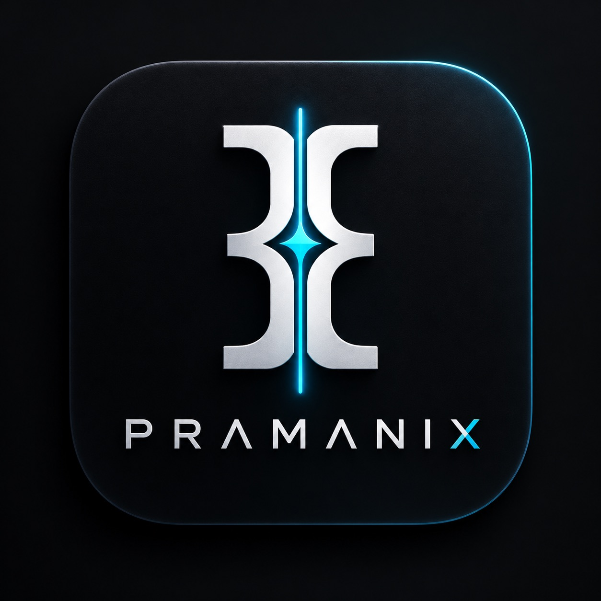

<div align="center">
  
  <br />
  <h1>P R A M A N I X</h1>
  <p><b>Autonomous AI Engineering Mentor, Capstone Project Architect & Oral Viva Defense Studio</b></p>
  
  <p>
    <a href="https://github.com/manthankro/pramanix-ai-"></a>
    
    
    
  </p>

  <p>Created by <b>Manthan</b> (<a href="https://github.com/manthankro">@manthankro</a>) • University Capstone & Engineering Workspace</p>\n  <p><b>Related repository:</b> <a href="https://github.com/manthankro/pramanix-ai-">pramanix-ai- — current project repository</a></p>
</div>

---

## 📌 Table of Contents
- [Overview](#-overview)
- [System Architecture](#-system-architecture)
- [Core Modules Breakdown](#-core-modules-breakdown)
  - [1. GitHub Repository Intelligence](#1-github-repository-intelligence)
  - [2. Capstone Project Builder & SRS Generator](#2-capstone-project-builder--srs-generator)
  - [3. Project Workspace & Delivery Roadmap](#3-project-workspace--delivery-roadmap)
  - [4. Engineering Conceptual Tutor](#4-engineering-conceptual-tutor)
  - [5. Oral Viva Defense Simulator](#5-oral-viva-defense-simulator)
  - [6. Algorithmic Debugger & Big-O Auditor](#6-algorithmic-debugger--big-o-auditor)
  - [7. PDF & Lecture Notes Assistant](#7-pdf--lecture-notes-assistant)
  - [8. Academic Research Assistant](#8-academic-research-assistant)
  - [9. Career & Technical Placement Hub](#9-career--technical-placement-hub)
  - [10. AI Study Companion](#10-ai-study-companion)
- [Dual-Platform Codebase Layout](#-dual-platform-codebase-layout)
- [High-Speed Inference Engine (Groq LPUs)](#-high-speed-inference-engine-groq-lpus)
- [Getting Started & Installation](#-getting-started--installation)
  - [🌐 Web Platform Setup](#-web-platform-setup)
  - [📱 Android Native App Setup](#-android-native-app-setup)
- [Environment Variables](#-environment-variables)
- [Author & License](#-author--license)

---

## 🌟 Overview

**Pramanix** is a full-featured, university-grade engineering mentor and capstone companion built for computer science, electrical, electronics, and mechanical engineering students. 

Traditional AI assistants give generic code snippets that often fail viva defense questioning. Pramanix is designed from first principles to simulate a **ruthless external university examiner**, auditing codebases for time/space complexity bottlenecks, verifying Software Requirements Specifications (SRS), and preparing students for oral defense.

Available as both:
1. **A High-Performance Web Studio:** React 19, TypeScript, Tailwind CSS, Vite, and Node.js.
2. **A Native Android Mobile Application:** Kotlin, Jetpack Compose, Material 3, and MVVM architecture.

---

## 🏛️ System Architecture

```
                                 ┌──────────────────────────────────────────────┐
                                 │                 USER CLIENTS                 │
                                 │   🌐 Web Studio (React)  │  📱 Android Native │
                                 └───────────────────────┬──────────────────────┘
                                                         │
                                        HTTP / JSON REST │ (Port 3000)
                                                         ▼
                                 ┌──────────────────────────────────────────────┐
                                 │        PRAMANIX HIGH-SPEED BACKEND           │
                                 │       (Node.js / Express / TypeScript)       │
                                 │  - Rate Limiter (60 req/min)                 │
                                 │  - AST Static Inspector                      │
                                 │  - Intelligent Multi-Provider Router         │
                                 └───────────────┬──────────────┬───────────────┘
                                                 │              │
                       Primary: ~180ms Latency   │              │ Fallback Backup
                                                 ▼              ▼
                                    ┌─────────────────┐   ┌────────────────────┐
                                    │    GROQ LPUs    │   │  GEMINI 3.8 FLASH  │
                                    │ (gpt-oss-120b)  │   │  (1M Token Window) │
                                    └─────────────────┘   └────────────────────┘
```

---

## 🧩 Core Modules Breakdown

### 1. GitHub Repository Intelligence
* **Live Inspection:** Connect to any GitHub repository (defaulting to `manthankro/pramanix-ai-`).
* **Dependency & AST Audit:** Inspect dependencies, entry points, licensing, and container configuration.
* **Oral Defense Generator:** Generates technical examiner trap questions tailored specifically to the analyzed repository.
* **1-Click Archive Downloader:** Instant `.zip` bundling of connected repository assets.

### 2. Capstone Project Builder & SRS Generator
* **Engineering Wizard:** Supports 6 primary domains:
  * Distributed Systems & Cloud Platforms
  * IoT & Embedded Firmware
  * Cybersecurity & Cryptography
  * Computer Vision & Edge AI
  * Robotics & Control Automation
  * Microservices & DevOps
* **Automated SRS Generation:** Creates formal Functional Requirements (FRs), Non-Functional Requirements (NFRs), and system boundary contracts.
* **1-Click Workspace Deployment:** Directly converts generated blueprints into starter boilerplate files (`main.py`, `Dockerfile`, `docs/SRS.md`) and Kanban milestone tasks.

### 3. Project Workspace & Delivery Roadmap
* **Milestone Roadmaps:** Structured across 4 academic milestones:
  * **M1:** Architecture, Problem Statement & SRS Formalization
  * **M2:** Core Subsystems & Async Queues
  * **M3:** Integration, Stress Testing & Big-O Validation
  * **M4:** Final Oral Viva Defense & Slide Deck
* **Integrated Code Editor:** Syntax-aware in-app code editor for python, markdown, dockerfiles, and configuration scripts.
* **Kanban Board:** Multi-stage task cards with status progression (`todo` ➔ `in_progress` ➔ `done`), priority indicators, and progress tracking.

### 4. Engineering Conceptual Tutor
* **Core Theory Breakdown:** Deep first-principle explanations across Operating Systems, DBMS, Computer Networks, and Data Structures.
* **Interactive Flashcards:** Tap-to-flip cards covering interview formulas, architectural laws, and boundary conditions.
* **Scored Concept Quizzes:** Practice MCQs with instant answer validation and academic justifications.

### 5. Oral Viva Defense Simulator
* **Simulated External Examiner:** Asks challenging, defense-critical questions on architectural trade-offs, race conditions, and failover recovery.
* **Rubric-Based Scoring:** Evaluates student oral responses on a 1-to-10 scale.
* **Exemplar Answers:** Reveals model benchmark answers explaining the mathematical and engineering rationale.

### 6. Algorithmic Debugger & Big-O Auditor
* **Complexity Breakdown:** Automatic derivation of worst-case and average-case Time $O(N)$ and Space $O(N)$ bounds.
* **Vulnerability & Bug Scan:** Flags concurrency race conditions, null references, unbuffered streams, and memory leaks.
* **Idiomatic Refactoring:** Generates clean, vectorized, production-grade implementations.
* **Automated Test Generation:** Generates comprehensive `unittest` / `pytest` test suites.

### 7. PDF & Lecture Notes Assistant
* **Exam Cheat-Sheet Generator:** Extracts fundamental laws, formulas, and sizing rules from raw lecture notes.
* **Semester Exam Prediction:** Predicts the top 5–10 viva defense and written exam questions from syllabus excerpts.

### 8. Academic Research Assistant
* **Literature Review Synthesizer:** Formulates problem statements and summaries of state-of-the-art architectures.
* **Methodological Comparison:** Generates benchmark comparison tables (Throughput, Latency, Fault Tolerance).
* **Citation Generator:** Formats citations in standard IEEE, APA, ACM, and Harvard styles.

### 9. Career & Technical Placement Hub
* **ATS Resume Bullet Optimizer:** Converts project accomplishments into high-impact Google XYZ-metric bullets.
* **System Design Interview Prep:** Practice distributed rate limiters, cache invalidation, and consistent hashing.

### 10. AI Study Companion
* **Real-time Engineering Chat:** High-speed technical mentor for quick mathematical derivations, algorithm visualization, and debugging.

---

## 📁 Dual-Platform Codebase Layout

```
pramanix/
├── src/                               # 🌐 Web Application (React 19, TypeScript)
│   ├── components/
│   │   ├── modules/                   # Individual module views (Github, Builder, Viva, etc.)
│   │   ├── common/                    # Pramanix brand logo & shared atoms
│   │   ├── Header.tsx                 # Glassmorphic top bar with live Groq LPU pill
│   │   └── Sidebar.tsx                # Categorized navigation with glowing status
│   ├── services/
│   │   └── api.ts                     # REST client connecting to backend
│   ├── types/
│   │   └── index.ts                   # Data models (Projects, Tasks, Viva, Repos)
│   ├── App.tsx                        # Main web layout & state manager
│   └── main.tsx                       # React DOM entry point
│
├── server.ts                          # ⚡ Node.js backend with Groq & Gemini router
│
├── app/                               # 📱 Native Android Mobile App (Kotlin + Compose)
│   ├── build.gradle.kts               # Android application configuration
│   └── src/main/
│       ├── AndroidManifest.xml        # Permissions and launcher activity
│       ├── java/com/aistudio/pramanix/
│       │   ├── MainActivity.kt        # Edge-to-edge Compose activity
│       │   ├── data/model/            # Kotlin data classes matching domain
│       │   ├── data/repository/       # In-memory reactive state repository
│       │   ├── ui/viewmodel/          # PramanixViewModel with StateFlow
│       │   ├── ui/theme/              # Material 3 Dark engineering theme
│       │   └── ui/screens/            # Jetpack Compose screen composables
│       └── res/                       # Adaptive icons & drawables
│
├── build.gradle.kts                   # Root Gradle build script
├── settings.gradle.kts                # Gradle settings script
├── gradle/libs.versions.toml          # Centralized version catalog
├── package.json                       # Web scripts & dependencies
└── README.md                          # Documentation
```

---

## ⚡ High-Speed Inference Engine (Groq LPUs)

Pramanix utilizes custom **Groq Language Processing Units (LPUs)** running `openai/gpt-oss-120b`, providing:
* **~180ms Latency:** Zero delay for realistic oral viva questioning.
* **Automated Fallback:** If Groq rate limits are ever reached, requests automatically route to **Gemini 3.8 Flash** without interrupting your session.

---

## 🚀 Getting Started & Installation

### 🌐 Web Platform Setup

1. **Clone the repository:**
   ```bash
   git clone https://github.com/manthankro/pramanix-ai-.git
   cd pramanix-ai-
   ```

2. **Install dependencies:**
   ```bash
   npm install
   ```

3. **Configure environment:**
   Create a `.env` file in the root directory:
   ```env
   GROQ_API_KEY=gsk_your_groq_api_key_here
   GROQ_MODEL=openai/gpt-oss-120b
   ```

4. **Launch development server:**
   ```bash
   npm run dev
   ```
   Open [http://localhost:3000](http://localhost:3000) in your browser.

---

### 📱 Android Native App Setup

1. Open the project in **Android Studio** (Koala or newer).
2. Ensure you have **JDK 21** and **Android SDK 36** installed.
3. Build the debug APK:
   ```bash
   gradle :app:assembleDebug
   ```
4. Output APK location:
   `app/build/outputs/apk/debug/app-debug.apk`

---

## 🔑 Environment Variables

| Variable | Description | Default |
| :--- | :--- | :--- |
| `GROQ_API_KEY` | Your Groq Cloud API Key (`gsk_...`) | *None* |
| `GROQ_MODEL` | Target Groq Model ID | `openai/gpt-oss-120b` |
| `GEMINI_API_KEY` | Optional Google AI Studio key for fallback | *Auto-detected* |
| `PORT` | Local web server port | `3000` |

---

## 👤 Author & License

* **Developer:** **Manthan** ([@manthankro](https://github.com/manthankro))
* **License:** [MIT License](LICENSE) — Feel free to use, modify, and build upon this project for engineering studies and capstones.
